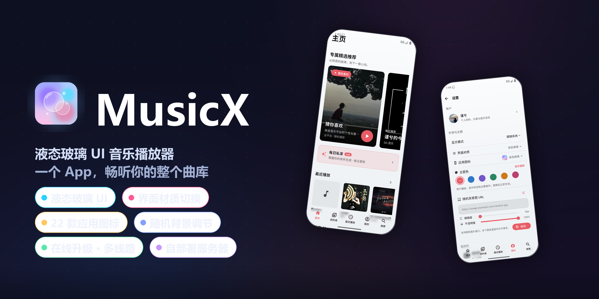

<div align="center">



# MusicX

**A liquid-glass music player for Android that streams from your own music server.**

Your music lives on your own disk. The interface stays in your hands.

[](https://github.com/singleton-altman/musixandroid/releases/latest)
[](https://github.com/singleton-altman/musixandroid/stargazers)
[](https://github.com/singleton-altman/musixandroid/commits/main)
[](https://flutter.dev)
[](#requirements)

[**Download APK**](https://github.com/singleton-altman/musixandroid/releases/latest)　·　[Quick start](#quick-start)　·　[Issues](https://github.com/singleton-altman/musixandroid/issues)　·　[Architecture](#architecture)　·　**English** / [中文](README.zh-CN.md)

</div>

---

## What is this

An **Android client for a self-hosted music server** (written in pure Flutter).

The server runs on your own computer, NAS or VPS, and the music sits on your own disks. Install this app on your phone, point it at the server, and you can play music, browse playlists, receive a daily recommendation and manage the queue. No need to keep a desktop or a browser open, and nothing passes through a third-party cloud.

## Quick start

|  | What to do | Details |
| :-: | --- | --- |
| **1** | Start your music server | Needs a Musix Hub compatible REST API running on your own device |
| **2** | Download and install the APK | Grab the latest from [Releases](https://github.com/singleton-altman/musixandroid/releases/latest), Android 8.0 or newer |
| **3** | Enter address and password | Open the app, type the server address, and the library starts syncing once you sign in |

## Requirements

| Item | Requirement |
| --- | --- |
| Phone OS | Android 8.0+ (minSdk 26) |
| Server | A deployed Musix Hub compatible service (defaults to `http://127.0.0.1:8080`) |
| Network | Direct LAN access, or reachable through a reverse proxy / tunnel |

> The first sign-in only needs an **address + password**. Connection details are used solely to reach your own library and are never uploaded to any third party.

## Build

Built with Flutter **3.47.4** (pinned in GitHub Actions). `liquid_glass_widgets 1.17.1` requires Flutter 3.41.0 or newer; the older 3.24 cannot compile.

<details>
<summary><b>First build (Windows)</b></summary>

<br>

The repository ships only hand-written source and Android configuration, so Gradle wrapper / gradlew / launcher icons and other generated scaffolding have to be filled in by Flutter:

```bash
# 1) Let Flutter generate the missing scaffolding
#    (gradle wrapper, gradlew, icons — existing lib/, pubspec.yaml and
#     hand-written files under android/app/src are kept)
flutter create --platforms=android --org com.musix .

# 2) Fetch dependencies
flutter pub get

# 3) Build the APK
flutter build apk --release
# Output: build/app/outputs/flutter-apk/app-release.apk
```

> If `flutter create` overwrites `AndroidManifest.xml`, restore this repository's version with git — it carries cleartext HTTP, the audio foreground service, the `musicx://` deep link and the home-screen widget declarations.

</details>

## Architecture

- Audio playback is delegated to the native player reading HTTP streams (Range requests plus auth headers), keeping a 3–5 minute native in-memory pre-buffer; on track changes and load timeouts the old engine is isolated and lock-screen controls rebind to the new engine
- The server is a Musix Hub REST API: cookie auth `musix_session` along with the reverse-proxy cookie, responses wrapped as `{result:{status,data,error}}`

| Responsibility | Implementation |
| --- | --- |
| State management | `provider` + `ChangeNotifier` (`lib/stores/`) |
| Networking | `lib/api/`, cookie auth and unified response-envelope parsing |
| Playback engine | `just_audio` + `audio_service`, native player reads HTTP streams with a custom cookie header |
| Image loading | `cached_network_image` with cookie header |
| Local persistence | `shared_preferences` (`lib/local/`) |
| Lock screen / notifications | `audio_service` media session |
| Home-screen widget | `home_widget` + Android AppWidget |
| Cover colour extraction | `palette_generator` |
| Icon switching | 22 `activity-alias` entries + `PackageManager.setComponentEnabledSetting` |
| In-app updates | GitHub Releases with multi-line acceleration / speed test / background download (`lib/services/`) |

## Project structure

```
lib/
├── app.dart            # app entry and root layout
├── theme/              # liquid-glass materials, route transitions, background layers
├── views/              # home, player, settings, update and other pages
├── services/           # update mirrors, speed test, icon switching
├── stores/             # UI state management
├── local/              # local persistence preferences
└── ...
android/                # platform shell (activity-alias icon switching, etc.)
tool/                   # icon / banner generation scripts (dart:ui, Pillow)
```

---

<div align="center">

<sub>

Chinese documentation: [**README.zh-CN.md**](README.zh-CN.md)

</sub>

</div>
